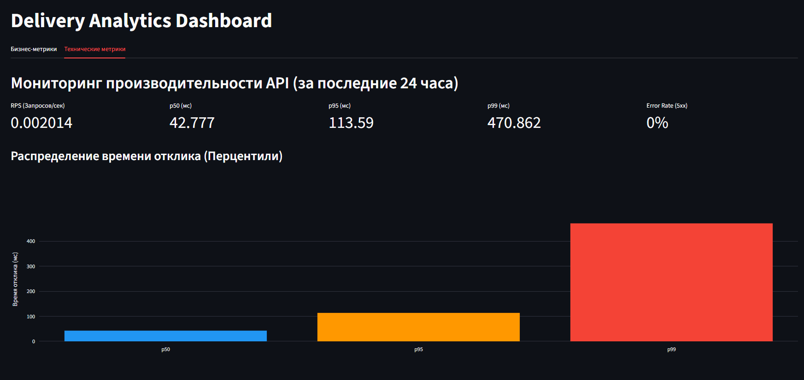
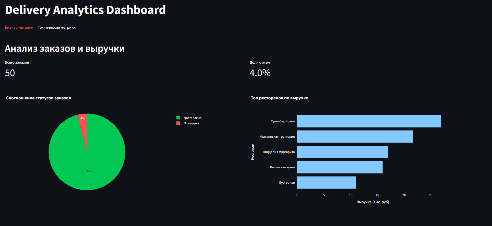

# 🚚 Delivery Analytics — API и BI-дашборд


Учебный аналитический проект для сервиса доставки: от хранения заказов и сбора HTTP-метаданных до агрегированных витрин и интерактивного BI-дашборда. FastAPI и MongoDB отвечают за данные и расчёт показателей, Streamlit и Plotly — за визуализацию бизнес-метрик и производительности API.

Проект демонстрирует работу с агрегациями, определением KPI, подготовкой данных для визуализации и разделением аналитического решения на слои: **источники → преобразование → витрины → дашборд**.

## ✅ Основные возможности

- ✅ Создание отдельных заказов и пакетная загрузка.
- ✅ Получение и фильтрация заказов по статусу, ресторану и пользователю.
- ✅ Пагинация и обновление стоимости или статуса заказа.
- ✅ Аналитические витрины: топ-5 ресторанов по сумме заказов, доля отмен и распределение заказов по дням недели.
- ✅ Сбор HTTP-метаданных: путь, метод, длительность обработки и статус ответа.
- ✅ Расчёт p50, p95, p99, среднего RPS и количества серверных ошибок.
- ✅ BI-дашборд с вкладками бизнес-метрик и технических метрик.
- ✅ Интерактивные диаграммы Plotly и карточки KPI.
- ✅ Кеширование запросов дашборда к API на 60 секунд.
- ✅ Генерация синтетических логов для проверки аналитики задержек.
- ✅ Запуск API, MongoDB и дашборда через Docker Compose.

## 🛠 Стек технологий

| Категория | Технология | Применение |
|---|---|---|
| Язык | Python 3.12 | API, обработка данных и дашборд |
| Backend | FastAPI 0.125.0 | REST API, аналитические эндпоинты, OpenAPI |
| Валидация | Pydantic ≥ 2.0.0 | Модели заказов и ответов |
| Хранение | MongoDB 7 | Коллекции заказов и HTTP-логов |
| Доступ к БД | PyMongo 4.19.0 | Запросы и aggregation pipelines |
| BI-интерфейс | Streamlit | Вкладки, карточки KPI и кеширование |
| Визуализация | Plotly | Круговая и столбчатые диаграммы |
| Подготовка данных | pandas | Табличное представление, сортировка и масштабирование сумм |
| HTTP-клиент | requests | Получение данных дашбордом через API |
| ASGI-сервер | Uvicorn 0.54.0 | Запуск FastAPI |
| Контейнеризация | Docker Compose | Совместный запуск трёх сервисов |
| Проверка API | Swagger UI, Postman | Ручные сценарии и тестовые данные |

Зависимости перечислены в `requirements.txt`. Версии Streamlit, Plotly, pandas и requests в текущем файле не закреплены.

## 🏗 Архитектура

```text
Заказы клиентов                         HTTP-запросы к API
      |                                         |
      v                                         v
FastAPI + Pydantic                     Middleware: извлечение
      |                               метаданных и расчёт времени
      v                                         |
MongoDB: orders                                 v
      |                                  LoggingService
      |                                         |
      |                                         v
      |                                  MongoDB: logs
      |                                         ^
      |                                         |
      |                               Генератор синтетических логов
      |                                         |
      v                                         v
/analytics/revenue                         /metrics
/analytics/cancelled                  RPS, p50/p95/p99,
/analytics/business                  число запросов и ошибок
      |                                         |
      +--------------------+--------------------+
                           |
                  Агрегированные JSON
                           |
                           v
                Streamlit + st.cache_data
                           |
                           v
                  pandas + Plotly
                 KPI и визуализации
```

В `app/main.py` подключены четыре роутера:

| Роутер | Ответственность |
|---|---|
| `orders.router` | Создание, чтение и обновление заказов |
| `analytics.router` | Бизнес-аналитика |
| `logs.router` | Генерация синтетических логов |
| `metrics.router` | Технические метрики |

База данных — `delivery_service`, коллекции — `orders` и `logs`. Адрес MongoDB задаётся через `MONGODB_URI`.

Дашборд получает данные через HTTP API и не обращается к MongoDB напрямую. Эндпоинт `/analytics/business` реализован в API, но пока не используется в интерфейсе.

## 📊 Визуализация и BI-дашборд

### Архитектура данных: от источника к витрине

В проекте реализованы два потока подготовки данных:

1. **Бизнес-данные:** заказ → валидация Pydantic → коллекция `orders` → агрегации MongoDB → `/analytics/*` → визуализация.
2. **Технические данные:** HTTP-запрос и ответ → middleware → структурированная запись в `logs` → агрегация `/metrics` → визуализация.

Сбор технических данных представляет собой простой **ETL-пайплайн внутри приложения**:

- **Extract:** middleware извлекает путь запроса, HTTP-метод и статус ответа.
- **Transform:** вычисляет длительность обработки в миллисекундах и формирует запись с временной меткой.
- **Load:** `LoggingService` сохраняет документ в MongoDB.

Middleware работает с HTTP-метаданными; чтение и агрегация сохранённых данных выполняются обработчиками API.

Эндпоинты `/analytics/*` и `/metrics` выполняют роль **вычисляемых витрин данных**: возвращают подготовленные показатели для потребителя. Агрегаты рассчитываются при запросе; отдельные материализованные коллекции и планировщик ETL пока не реализованы.

### Бизнес-метрики

Первая вкладка помогает оценить объём заказов, отмены и вклад ресторанов:

| Элемент | Источник | Что показывает |
|---|---|---|
| KPI «Всего заказов» | `/analytics/cancelled` | Общее количество заказов |
| KPI «Доля отмен» | `/analytics/cancelled` | Долю `CANCELLED`, переведённую в проценты |
| Круговая диаграмма | `/analytics/cancelled` | Отменённые и остальные заказы |
| Горизонтальная диаграмма выручки | `/analytics/revenue` | Топ-5 ресторанов по сумме `total_price`, в тысячах рублей |

Перед построением диаграммы суммы преобразуются в pandas DataFrame, сортируются и делятся на 1000.

**Семантика показателей:** «выручка» в текущей реализации — сумма стоимости заказов всех статусов, включая отменённые. Отдельной карточки общей выручки нет. Сектор «Доставлено» в интерфейсе фактически включает все заказы, кроме `CANCELLED`, поэтому его следует интерпретировать как «Не отменено».



### Технические метрики и основа для мониторинга SLA

Вторая вкладка запрашивает `/metrics?time=24` и показывает показатели за последние 24 часа:

- **RPS** — среднее количество запросов в секунду за выбранное окно.
- **p50, p95, p99** — значения задержки в миллисекундах.
- **Столбчатую диаграмму перцентилей** — сравнение типичных задержек и медленного хвоста распределения.

Эти показатели служат основой для **мониторинга SLA** и ручного сопоставления задержек с целевыми значениями. Автоматическая проверка порогов SLA, индикаторы нарушений и оповещения пока не реализованы.

В интерфейсе также есть карточка `Error Rate (5xx)`, однако API возвращает `total_errors` и `total_requests`, а поле `error_rate` отсутствует. Сейчас карточка использует значение `0` по умолчанию; фактическая доля ошибок в ней не рассчитывается.



### Кеширование

Функция получения данных декорирована `@st.cache_data(ttl=60)`. Повторные обращения к одному эндпоинту могут использовать сохранённый результат, снижая число HTTP-запросов и повторных агрегаций MongoDB.

TTL кеша не означает автоматическое обновление страницы: после его истечения свежие данные загружаются при следующем выполнении функции.

### Запуск дашборда

После установки зависимостей и запуска API выполните из корня проекта:

```bash
streamlit run dashboard/app.py
```

Откройте [дашборд](http://localhost:8501). По умолчанию он обращается к API по адресу `http://localhost:8000`.

Для запуска всего проекта в контейнерах:

```bash
docker-compose up --build
```

Эквивалентная команда Docker Compose:

```bash
docker compose up --build
```

Compose передаёт дашборду `API_URL=http://api:8000` и публикует интерфейс на порту `8501`.

## 📖 API Reference

Базовый адрес: `http://localhost:8000`.

### Маршруты приложения

| Метод | Путь | Назначение | Успешный статус |
|---|---|---|---|
| GET | `/orders` | Список заказов, фильтры и пагинация | 200 |
| GET | `/orders/{order_id}` | Получение заказа | 200 |
| POST | `/orders` | Создание заказа | 201 |
| POST | `/orders/bulk` | Пакетное создание | 201 |
| PUT | `/orders/{order_id}` | Изменение стоимости и/или статуса | 200 |
| GET | `/analytics/revenue` | Топ-5 ресторанов по сумме заказов | 200 |
| GET | `/analytics/cancelled` | Количество и доля отмен | 200 |
| GET | `/analytics/business` | Заказы по дням недели | 200 |
| POST | `/logs/generate_fake` | Генерация синтетических логов | 200 |
| GET | `/metrics` | Метрики запросов за период | 200 |

Служебные GET-маршруты FastAPI: `/docs`, `/redoc`, `/openapi.json`, `/docs/oauth2-redirect`. Авторизация в приложении не реализована.

### О примерах

Примеры соответствуют моделям и логике обработчиков. Данные заказов взяты из Postman-коллекции; аналитические результаты рассчитаны для её исходного пакета из 50 заказов.

Это ожидаемые результаты по коду, а не сохранённые ответы интеграционного теста. `<generated_id>` обозначает ObjectId, который необходимо заменить идентификатором из ответа API.

### `POST /orders`

Тело запроса:

```json
{
  "user": "Иван Петров",
  "restaurant": "Пиццерия Маргарита",
  "total_price": 1200.0,
  "status": "DELIVERED",
  "items": [
    {
      "dish": "Пицца Маргарита",
      "quantity": 2,
      "price": 600.0
    }
  ],
  "created_at": "2026-10-11T12:30:00"
}
```

Ответ `201`:

```json
{
  "id": "<generated_id>",
  "user": "Иван Петров",
  "restaurant": "Пиццерия Маргарита",
  "total_price": 1200.0,
  "status": "DELIVERED",
  "items": [
    {
      "dish": "Пицца Маргарита",
      "quantity": 2,
      "price": 600.0
    }
  ],
  "created_at": "2026-10-11T12:30:00"
}
```

Обязательные поля: `user`, `restaurant`, `total_price`, `items`. По умолчанию `status` равен `"CREATED"`, а `created_at` заполняется через `datetime.now()`.

Сумма заказа не пересчитывается по позициям. Статус принимает произвольную строку.

### `GET /orders`

| Параметр | Тип | По умолчанию | Назначение |
|---|---|---|---|
| `status` | string | Не задан | Точное совпадение статуса |
| `restaurant` | string | Не задан | Точное совпадение ресторана |
| `user` | string | Не задан | Точное совпадение пользователя |
| `skip` | integer | `0` | Количество пропускаемых записей |
| `limit` | integer | `50` | Лимит записей |

```http
GET /orders?status=DELIVERED&skip=0&limit=1
```

Пример ответа для созданного выше заказа:

```json
[
  {
    "id": "<generated_id>",
    "user": "Иван Петров",
    "restaurant": "Пиццерия Маргарита",
    "total_price": 1200.0,
    "status": "DELIVERED",
    "items": [
      {"dish": "Пицца Маргарита", "quantity": 2, "price": 600.0}
    ],
    "created_at": "2026-10-11T12:30:00"
  }
]
```

Фильтры можно сочетать. Явная сортировка и общее количество записей не предусмотрены. При отсутствии совпадений возвращается `[]`.

### `GET /orders/{order_id}`

```http
GET /orders/<generated_id>
```

Ответ `200` — объект заказа того же формата, что в ответе `POST /orders`.

При некорректном формате ObjectId возвращается `404`:

```json
{
  "detail": "Заказ не найден"
}
```

Корректный по формату, но отсутствующий идентификатор пока приводит к серверной ошибке.

### `POST /orders/bulk`

Принимает массив заказов:

```json
[
  {
    "user": "Иван Петров",
    "restaurant": "Пиццерия Маргарита",
    "total_price": 1200.0,
    "status": "DELIVERED",
    "items": [
      {"dish": "Пицца Маргарита", "quantity": 2, "price": 600.0}
    ],
    "created_at": "2026-10-11T12:30:00"
  }
]
```

Ответ `201`:

```json
{
  "inserted_count": 1,
  "inserted_ids": ["<generated_id>"]
}
```

В Postman-коллекции есть пакет из 50 заказов. Переданные в нём поля `id` не входят в `OrderCreate` и игнорируются: MongoDB создаёт новые идентификаторы.

Пустой массив отдельно не обрабатывается.

### `PUT /orders/{order_id}`

Обновляет только `total_price` и/или `status` через `$set`.

```http
PUT /orders/<generated_id>
Content-Type: application/json
```

```json
{
  "status": "CANCELLED"
}
```

Пример ответа `200`:

```json
{
  "id": "<generated_id>",
  "user": "Иван Петров",
  "restaurant": "Пиццерия Маргарита",
  "total_price": 1200.0,
  "status": "CANCELLED",
  "items": [
    {"dish": "Пицца Маргарита", "quantity": 2, "price": 600.0}
  ],
  "created_at": "2026-10-11T12:30:00"
}
```

Значения `null` исключаются из обновления. Если обновлять нечего, возвращается `400`:

```json
{
  "detail": "Нет данных для обновления"
}
```

Проверка отсутствующего заказа с корректным ObjectId пока не реализована.

### `GET /analytics/revenue`

```http
GET /analytics/revenue
```

Группирует заказы по ресторану, суммирует `total_price` и возвращает пять наибольших сумм.

Ожидаемый ответ после однократной загрузки исходного пакета Postman в пустую коллекцию:

```json
[
  {"restaurant": "Суши-бар Токио", "total_revenue": 26900.0},
  {"restaurant": "Итальянская траттория", "total_revenue": 21700.0},
  {"restaurant": "Пиццерия Маргарита", "total_revenue": 17000.0},
  {"restaurant": "Китайская кухня", "total_revenue": 16000.0},
  {"restaurant": "Бургерная", "total_revenue": 11000.0}
]
```

Учитываются все статусы и все даты. Для пустой коллекции возвращается `[]`.

### `GET /analytics/cancelled`

```http
GET /analytics/cancelled
```

Ожидаемый ответ для исходного пакета Postman:

```json
{
  "total_orders": 50,
  "cancelled_orders": 2,
  "cancelled_rate": 0.04
}
```

Отменённым считается заказ со статусом строго `"CANCELLED"`. Значение `0.04` означает 4%.

На пустой коллекции обработчик завершается ошибкой: перед проверкой загрузите заказы.

### `GET /analytics/business`

```http
GET /analytics/business
```

Ожидаемый ответ для исходного пакета Postman:

```json
[
  {"total_orders": 11, "day": "Sunday"},
  {"total_orders": 7, "day": "Monday"},
  {"total_orders": 7, "day": "Tuesday"},
  {"total_orders": 7, "day": "Wednesday"},
  {"total_orders": 6, "day": "Thursday"},
  {"total_orders": 6, "day": "Friday"},
  {"total_orders": 6, "day": "Saturday"}
]
```

Группировка выполняется по `created_at`, порядок — от воскресенья до субботы. Дни без заказов не добавляются. Для пустой коллекции возвращается `[]`.

### `POST /logs/generate_fake`

Пример запроса на одну запись за последние сутки:

```json
{
  "number_of_logs": 1,
  "days": 1
}
```

Ответ:

```json
[
  "<generated_log_id>"
]
```

Для наполнения технической витрины можно передать `number_of_logs: 100`.

Путь и метод выбираются из OpenAPI-схемы. Статус `200` генерируется с вероятностью 98%, `505` — 2%. Задержки содержат обычные значения и редкие выбросы.

Генератор записывает документы в MongoDB и не выполняет реальные HTTP-запросы. Сам вызов генератора дополнительно логируется middleware.

### `GET /metrics`

```http
GET /metrics?time=24
```

`time` — период анализа в часах, тип `float`, значение по умолчанию — `1`.

В текущей версии API возвращается **один JSON-объект**, а не массив.

| Поле | Расчёт |
|---|---|
| `total_requests` | Количество логов в окне |
| `total_errors` | Количество записей со `status_code >= 500` |
| `p50` | Элемент отсортированных задержек с индексом `floor(N / 2)` |
| `p95` | Элемент с индексом `floor(N × 0.95)` |
| `p99` | Элемент с индексом `floor(N × 0.99)` |
| `rps` | `N / (time × 3600)` |

Для иллюстрации формата: если в часовое окно попал ровно один лог с задержкой 50 мс и статусом 200, результат расчёта будет следующим:

```json
{
  "total_requests": 1,
  "total_errors": 0,
  "p50": 50.0,
  "p95": 50.0,
  "p99": 50.0,
  "rps": 0.0002777777777777778
}
```

Это условный пример расчёта, а не сохранённый ответ сервера.

Перцентили выбираются без интерполяции. Реальные и синтетические логи учитываются вместе. Запрос `/metrics` записывается после расчёта и не входит в собственный ответ.

Передавайте положительный `time`. Если в выбранном окне нет записей, текущий обработчик завершается ошибкой при обращении к первому элементу пустого результата.

## 🚀 Быстрый старт

### Вариант 1. Docker Compose

Из корневой директории:

```bash
docker compose up --build
```

Или:

```bash
docker-compose up --build
```

| Сервис | Адрес | Назначение |
|---|---|---|
| Dashboard | [localhost:8501](http://localhost:8501) | BI-интерфейс |
| API / Swagger UI | [localhost:8000/docs](http://localhost:8000/docs) | Проверка API |
| ReDoc | [localhost:8000/redoc](http://localhost:8000/redoc) | Документация |
| MongoDB | `localhost:27017` | База данных |

Compose передаёт следующие настройки:

```text
api:
  MONGODB_URI=mongodb://mongo:27017/delivery_service

dashboard:
  API_URL=http://api:8000
```

Заказы и логи сохраняются в именованном томе `mongo_data`.

Для остановки:

```bash
docker compose down
```

Обычная остановка сохраняет том с данными.

В Compose настроен порядок запуска через `depends_on`, но healthcheck отсутствует. После запуска дождитесь готовности API и MongoDB. Если дашборд открылся раньше, повторите загрузку после готовности сервисов и истечения кеша.

> **Примечание для Windows**
>
> Для Docker Desktop используйте Linux-контейнеры и backend WSL 2. Убедитесь, что Docker Desktop запущен, а порты `8000`, `8501` и `27017` свободны. Команды можно выполнять из PowerShell в корне проекта.

### Вариант 2. Локальный запуск

Понадобятся Python 3.12 и MongoDB 7.

При наличии Docker можно запустить только базу:

```bash
docker compose up -d mongo
```

Создайте окружение:

```bash
python -m venv .venv
```

Активация в Linux/macOS:

```bash
source .venv/bin/activate
```

Активация в Windows PowerShell:

```powershell
.\.venv\Scripts\Activate.ps1
```

Установите зависимости:

```bash
python -m pip install -r requirements.txt
```

Запустите API:

```bash
python -m uvicorn app.main:app --reload --host 127.0.0.1 --port 8000
```

Во втором терминале активируйте то же окружение и запустите дашборд:

```bash
streamlit run dashboard/app.py
```

Откройте [дашборд](http://localhost:8501).

### Переменные окружения

| Переменная | Значение по умолчанию | Где используется |
|---|---|---|
| `MONGODB_URI` | `mongodb://localhost:27017` | API |
| `API_URL` | `http://localhost:8000` | Дашборд |

Linux/macOS:

```bash
export MONGODB_URI="mongodb://localhost:27017"
export API_URL="http://localhost:8000"
```

Windows PowerShell:

```powershell
$env:MONGODB_URI = "mongodb://localhost:27017"
$env:API_URL = "http://localhost:8000"
```

Задавайте переменные перед запуском соответствующего процесса. Автоматическая загрузка `.env` не реализована.

## 📁 Структура проекта

```text
delivery-analytics-api/
├── app/
│   ├── main.py                   # FastAPI, middleware и подключение роутеров
│   ├── database.py               # Доступ к коллекциям MongoDB
│   ├── models.py                 # Pydantic-модели
│   ├── routers/
│   │   ├── orders.py             # Создание, чтение и обновление заказов
│   │   ├── analytics.py          # Вычисляемые бизнес-витрины
│   │   ├── logs.py               # Генерация синтетических логов
│   │   └── metrics.py            # Витрина технических метрик
│   └── services/
│       ├── logging_service.py   # Формирование и сохранение логов
│       └── random_service.py    # Случайные маршруты, даты и задержки
├── dashboard/
│   └── app.py                   # Streamlit, кеширование и графики Plotly
├── docs/
│   └── screenshots/
│       ├── dashboard_business.png # Бизнес-вкладка
│       └── dashboard_tech.png     # Техническая вкладка
├── postman/
│   └── postman_collection.json  # Запросы API и пакет из 50 заказов
├── .dockerignore                # Исключения из Docker-контекста
├── .gitignore                   # Исключения для Git
├── Dockerfile                   # Общий образ API и дашборда
├── docker-compose.yml           # API, MongoDB, дашборд и том данных
├── requirements.txt             # Зависимости
└── README.md                    # Документация
```

## 💡 Ключевые технические решения

1. **Вычисляемые витрины данных на MongoDB.**  
   Бизнес-правила агрегации вынесены в API: группировка по ресторанам и дням недели, доля отмен, технические показатели. Дашборд получает компактные результаты расчётов. Используются `$group`, `$sum`, `$sort`, `$dayOfWeek`, `$switch`, `$sortArray` и `$arrayElemAt`.

2. **ETL-пайплайн для HTTP-метаданных.**  
   Middleware извлекает атрибуты запроса и ответа, рассчитывает длительность и передаёт структурированную запись в `LoggingService`. Общий формат логов позволяет применять одинаковые агрегации к реальным и синтетическим данным.

3. **Кеширование и подготовка данных для BI.**  
   `st.cache_data(ttl=60)` уменьшает повторные обращения к API. pandas используется для сортировки и преобразования денежных значений перед визуализацией, а Plotly — для интерактивного представления показателей.

4. **Перцентили как основа мониторинга SLA.**  
   p50, p95 и p99 позволяют оценивать как типичную задержку, так и медленные запросы. Генератор с редкими выбросами помогает исследовать поведение этих показателей. Автоматическое сравнение с SLA-порогами остаётся следующим этапом развития.

## 🧪 Тестирование и демонстрация

В репозитории есть Postman-коллекция для ручной проверки. Автоматизированного набора тестов пока нет.

### Проверка API через Swagger UI

1. Откройте [Swagger UI](http://localhost:8000/docs).
2. Создайте заказ через `POST /orders` и сохраните возвращённый `id`.
3. Получите заказ через `GET /orders/{order_id}`.
4. Проверьте фильтрацию через `GET /orders?status=DELIVERED`.
5. Измените статус через `PUT /orders/{order_id}`.
6. Повторно получите заказ и проверьте изменение.
7. Проверьте ответы аналитических эндпоинтов.
8. Проверьте ошибки: некорректный ObjectId → `404`, пустое обновление → `400`, отсутствие обязательных полей заказа → `422`.

### Демонстрация бизнес-дашборда

1. Импортируйте `postman/postman_collection.json`.
2. Для воспроизводимых результатов загрузите исходный пакет через `/orders/bulk` один раз в пустую коллекцию заказов.
3. Проверьте `inserted_count: 50`.
4. Откройте [дашборд](http://localhost:8501).
5. На бизнес-вкладке проверьте:
   - всего заказов — **50**;
   - доля отмен — **4%**;
   - лидер по сумме заказов — **«Суши-бар Токио», 26,9 тыс. руб.**.
6. Сопоставьте диаграммы с ответами `/analytics/cancelled` и `/analytics/revenue`.

Повторная загрузка пакета создаёт новые заказы. После изменения данных учитывайте TTL кеша и повторно запускайте страницу для получения свежих результатов.

### Демонстрация технической витрины

Выполните `POST /logs/generate_fake`:

```json
{
  "number_of_logs": 100,
  "days": 1
}
```

Затем:

1. Проверьте, что возвращены 100 идентификаторов.
2. Запросите `/metrics?time=24`.
3. Откройте техническую вкладку дашборда.
4. Проверьте RPS, карточки p50/p95/p99 и диаграмму задержек.
5. Учитывайте, что запросы самого дашборда также попадают в логи, а кеширование может создавать различия между моментами получения данных.

Карточка Error Rate пока не подходит для проверки реальной доли ошибок: её расчёт необходимо согласовать с API.

### Текущие ограничения

- Автоматическая проверка SLA и оповещения отсутствуют.
- Бизнес-аналитика не фильтруется по периоду; техническая вкладка использует фиксированное окно 24 часа.
- Подпись «Доставлено» включает все неотменённые статусы.
- API не возвращает поле `error_rate`, ожидаемое карточкой дашборда.
- Пустые выборки `/analytics/cancelled` и `/metrics` приводят к ошибке.
- Отсутствующие заказы с корректным ObjectId не обработаны в GET и PUT.
- Не заданы ограничения на положительность цен, количества и временных диапазонов.
- Реальные и синтетические логи не разделены.
- Middleware записывает логи синхронно и не сохраняет запись при необработанном исключении до получения ответа.
- Нет общего жизненного цикла MongoClient, явно создаваемых индексов и TTL для логов.
- Расчёт перцентилей собирает и сортирует все задержки выбранного окна.
- Аутентификация и разграничение доступа не реализованы.

## 🔮 Future Work

- [ ] Интеграция с enterprise BI-системами (Apache Superset / Yandex DataLens) через прямое подключение к витринам данных.
- [ ] Подготовка материализованных витрин и совместимого слоя доступа для внешних BI-инструментов.
- [ ] Автоматическая проверка порогов SLA для p95/p99 и индикация нарушений.
- [ ] Расчёт Error Rate как `total_errors / total_requests × 100` с обработкой нулевого знаменателя.
- [ ] Уточнение бизнес-семантики: отдельный учёт доставленных заказов и согласованные правила расчёта выручки.
- [ ] Фильтры периода и ресторана в дашборде и аналитическом API.
- [ ] Визуализация распределения заказов по дням недели.
- [ ] Обработка пустых витрин и отсутствующих заказов.
- [ ] Валидация диапазонов значений и допустимых статусов.
- [ ] Разделение синтетических и реальных логов.
- [ ] Общий клиент MongoDB, индексы и TTL для логов.
- [ ] Авторизация и роли доступа.
- [ ] Healthcheck сервисов, автоматизированные тесты и CI.